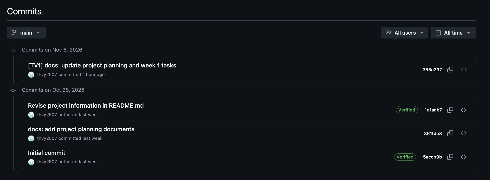

# Git Commit Log Total — Week 05

## 1. General Information

- **Group ID:** Group02
- **Project Name:** Personal Finance Manager
- **Course:** CS160-26A01
- **Reporting Period:** 28/10/2026 – 06/11/2026
- **GitHub Repository:** https://github.com/thvy2507/CS160-Group02-FinalProject
- **Branch:** `main`

This document records the cumulative Git commit history of Group02 from the beginning of the project through November 6, 2026.

---

## 2. Team Member & GitHub Account Mapping

| Member | Student ID | Full Name          | GitHub Username |
| ------ | ---------- | ------------------ | --------------- |
| TV1    | 25125049   | Trần Hồng Vy       | `thvy2507`      |
| TV2    | 26125041   | Lê Thiện Khôi      | `k12khoi`       |
| TV3    | 26125089   | Dương Thị Nhã Uyên | `Nhauyn`        |
| TV4    | 26125070   | Trần Nhật Tân      | `Tan-TN`        |

---

## 3. Cumulative Git Commit Log

**25125049 - Trần Hồng Vy (TV1)**

> **GitHub Username:** `thvy2507`
>
> **Total Commits:** 4

| Date       | Commit Hash | Commit Message                                       |
| ---------- | ----------- | ---------------------------------------------------- |
| 28/10/2026 | `5accb9b`   | Initial commit                                       |
| 28/10/2026 | `361fde8`   | docs: add project planning documents                 |
| 28/10/2026 | `1e1aab7`   | Revise project information in README.md              |
| 06/11/2026 | `355c337`   | [TV1] docs: update project planning and week 1 tasks |

**Evidences:**

**Commit Details:**

- **Commit 1 — `5accb9b`**
  - **Date:** 28/10/2026
  
  - **Message:** `Initial commit`
  
  - **Files:** `.gitignore`, `README.md`
  
  - **Description:** Initialized the GitHub repository with the initial README and Git ignore configuration.
  
  - **Link:** https://github.com/thvy2507/CS160-Group02-FinalProject/commit/5accb9b
  
- **Commit 2 — `361fde8`**
  - **Date:** 28/10/2026
  
  - **Message:** `docs: add project planning documents`
  
  - **Files:** `.gitignore`, `CODING_RULES.md`, `FILE_STRUCTURE.md`, `README.md`, `ROLES.md`, `WEEKLY_PLAN.md`
  
  - **Description:** Added the main project planning documents, including team responsibilities, development roadmap, file structure, and coding conventions.
  
  - **Link:** https://github.com/thvy2507/CS160-Group02-FinalProject/commit/361fde8
  
- **Commit 3 — `1e1aab7`**
  - **Date:** 28/10/2026
  
  - **Message:** `Revise project information in README.md`
  
  - **Files:** `README.md`
  
  - **Description:** Revised the project information and documentation in the repository README.
  
  - **Link:** https://github.com/thvy2507/CS160-Group02-FinalProject/commit/1e1aab7
  
- **Commit 4 — `355c337`**
- **Date:** 06/11/2026
  
- **Message:** `[TV1] docs: update project planning and week 1 tasks`
  
- **Files:** `CODING_RULES.md`, `WEEKLY_PLAN.md`, `docs/plans/plan_for_week_1.md`
  
- **Description:** Updated the weekly development workflow, revised planning documents, and added the detailed Week 1 task assignments.
  
- **Link:** https://github.com/thvy2507/CS160-Group02-FinalProject/commit/355c337

**26125041 - Lê Thiện Khôi (TV2)**

> **GitHub Username:** k12khoi
>
> **Total Commits:** 0

**26125089 - Dương Thị Nhã Uyên (TV3)**

>  **GitHub Username:** Nhauyn
>
> **Total Commits Found:** 0

**26125070 - Trần Nhật Tân (TV4)**

>  **GitHub Username:** Tan-TN
>
> **Total Commits Found:** 0

---

## 4. Commit Summary

| Member                   | Total Commits | Main Contributions                                           |
| ------------------------ | ------------: | ------------------------------------------------------------ |
| TV1 - Trần Hồng Vy       |             4 | Repository initialization, project documentation, development planning |
| TV2 - Lê Thiện Khôi      |             0 | No commits recorded                                          |
| TV3 - Dương Thị Nhã Uyên |             0 | No commits recorded                                          |
| TV4 - Trần Nhật Tân      |             0 | No commits recorded                                          |
| **Total**                |         **4** |                                                              |

