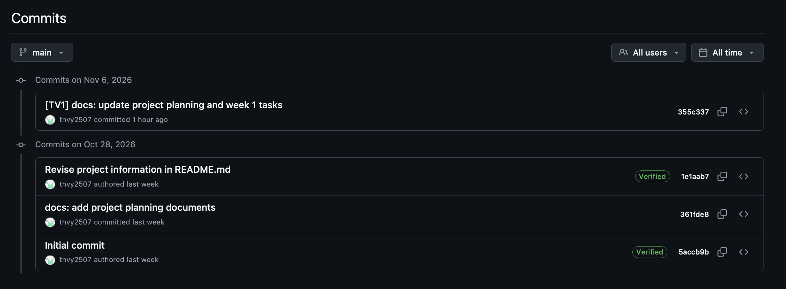
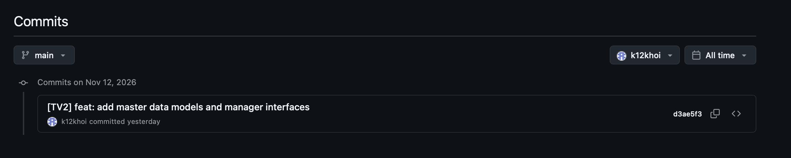
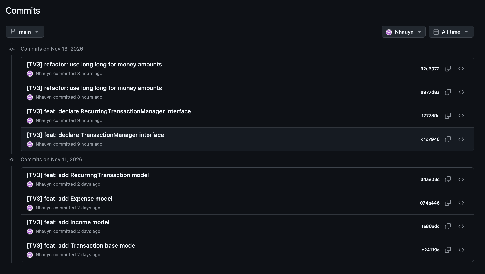
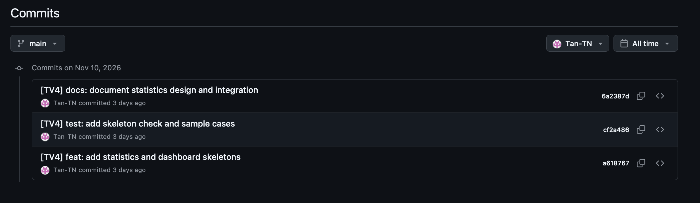

# Git Commit Log Total — Week 06

## 1. General Information

- **Group ID:** Group02
- **Project Name:** Personal Finance Manager
- **Course:** CS160-26A01
- **Reporting Period:** 28/10/2026 – 13/11/2026
- **GitHub Repository:** https://github.com/thvy2507/CS160-Group02-FinalProject
- **Branch:** `main`

This document records the **cumulative Git commit history** reachable from `main` from project initialization through **13 November 2026**, including commits originally developed on feature branches and subsequently merged.

**Counting rules:** Commits are attributed to their GitHub author and dated in **Vietnam time (UTC+07:00)**. TV1’s four GitHub PR merge commits and one local branch merge commit are included in TV1’s count, but are identified separately from development commits to avoid implying duplicate implementation work. This is a commit-history count, not a measure of lines contributed.

**Reconciliation with Week 05:** The previously submitted Week 05 file listed four commits. The current verified history also contains commit `2bca733` on 06/11/2026, which was not listed there. All 34 commits are included here, without silently carrying forward the earlier undercount.

---

## 2. Team Member & GitHub Account Mapping

| Member | Student ID | Full Name          | GitHub Username |
| ------ | ---------- | ------------------ | --------------- |
| TV1    | 25125049   | Trần Hồng Vy       | `thvy2507`      |
| TV2    | 26125041   | Lê Thiện Khôi      | `k12khoi`       |
| TV3    | 26125089   | Dương Thị Nhã Uyên | `Nhauyn`        |
| TV4    | 26125070   | Trần Nhật Tân      | `Tan-TN`        |

---

## 3. Cumulative Git Commit Log

**25125049 - Trần Hồng Vy (TV1)**

> **GitHub Username:** `thvy2507`  
> **Total Commits:** 22 (including 5 merge commits)

| Date       | Commit Hash                                                  | Commit Message                                              |
| ---------- | ------------------------------------------------------------ | ----------------------------------------------------------- |
| 28/10/2026 | [`5accb9b`](https://github.com/thvy2507/CS160-Group02-FinalProject/commit/5accb9b) | Initial commit                                              |
| 28/10/2026 | [`361fde8`](https://github.com/thvy2507/CS160-Group02-FinalProject/commit/361fde8) | docs: add project planning documents                        |
| 28/10/2026 | [`1e1aab7`](https://github.com/thvy2507/CS160-Group02-FinalProject/commit/1e1aab7) | Revise project information in README.md                     |
| 06/11/2026 | [`355c337`](https://github.com/thvy2507/CS160-Group02-FinalProject/commit/355c337) | [TV1] docs: update project planning and week 1 tasks        |
| 06/11/2026 | [`2bca733`](https://github.com/thvy2507/CS160-Group02-FinalProject/commit/2bca733) | [TV1] docs: add week 5 submission report                    |
| 07/11/2026 | [`adcdd29`](https://github.com/thvy2507/CS160-Group02-FinalProject/commit/adcdd29) | [TV1] build: initialize project structure                   |
| 07/11/2026 | [`2940d00`](https://github.com/thvy2507/CS160-Group02-FinalProject/commit/2940d00) | [TV1] build: set up CMake and CLI skeleton                  |
| 11/11/2026 | [`0dd49fa`](https://github.com/thvy2507/CS160-Group02-FinalProject/commit/0dd49fa) | [TV1] feat: implement DynamicArray core                     |
| 11/11/2026 | [`8ea082c`](https://github.com/thvy2507/CS160-Group02-FinalProject/commit/8ea082c) | [TV1] feat: extend DynamicArray operations                  |
| 11/11/2026 | [`d06f4f9`](https://github.com/thvy2507/CS160-Group02-FinalProject/commit/d06f4f9) | [TV1] test: add DynamicArray tests                          |
| 12/11/2026 | [`d91da5d`](https://github.com/thvy2507/CS160-Group02-FinalProject/commit/d91da5d) | [TV1] feat: implement Date utilities                        |
| 12/11/2026 | [`25cef6b`](https://github.com/thvy2507/CS160-Group02-FinalProject/commit/25cef6b) | [TV1] test: add Date validation and comparison tests        |
| 13/11/2026 | [`074c19b`](https://github.com/thvy2507/CS160-Group02-FinalProject/commit/074c19b) | Merge pull request #6 from thvy2507/feat/core-setup         |
| 13/11/2026 | [`ae4934e`](https://github.com/thvy2507/CS160-Group02-FinalProject/commit/ae4934e) | [TV1] refactor: standardize master data interfaces          |
| 13/11/2026 | [`cef8b13`](https://github.com/thvy2507/CS160-Group02-FinalProject/commit/cef8b13) | [TV1] fix: align master data naming and comments            |
| 13/11/2026 | [`c26a315`](https://github.com/thvy2507/CS160-Group02-FinalProject/commit/c26a315) | Merge pull request #7 from thvy2507/feat/master-data-models |
| 13/11/2026 | [`277ed28`](https://github.com/thvy2507/CS160-Group02-FinalProject/commit/277ed28) | [TV1] refactor: standardize transaction interfaces          |
| 13/11/2026 | [`f2b9915`](https://github.com/thvy2507/CS160-Group02-FinalProject/commit/f2b9915) | Merge pull request #8 from thvy2507/feat/transaction-models |
| 13/11/2026 | [`e6fc147`](https://github.com/thvy2507/CS160-Group02-FinalProject/commit/e6fc147) | [TV1] refactor: align statistics with shared interfaces     |
| 13/11/2026 | [`e6f58a8`](https://github.com/thvy2507/CS160-Group02-FinalProject/commit/e6f58a8) | Merge origin/main into feat/statistics-design               |
| 13/11/2026 | [`8ed5371`](https://github.com/thvy2507/CS160-Group02-FinalProject/commit/8ed5371) | [TV1] build: integrate statistics and dashboard modules     |
| 13/11/2026 | [`f27c225`](https://github.com/thvy2507/CS160-Group02-FinalProject/commit/f27c225) | Merge pull request #5 from thvy2507/feat/statistics-design  |

**Evidence:** 

.png)

.png)

**Commit Details:**

- **Commit 1 — [`5accb9b`](https://github.com/thvy2507/CS160-Group02-FinalProject/commit/5accb9b)** (28/10/2026)
  - **Message:** `Initial commit`
  - **Files:** `.gitignore`, `README.md`
  - **Description:** Initialized the repository with its README and Git ignore rules.

- **Commit 2 — [`361fde8`](https://github.com/thvy2507/CS160-Group02-FinalProject/commit/361fde8)** (28/10/2026)
  - **Message:** `docs: add project planning documents`
  - **Files:** `.gitignore`, `CODING_RULES.md`, `FILE_STRUCTURE.md`, `README.md`, `ROLES.md`, `WEEKLY_PLAN.md`
  - **Description:** Added the team roles, coding rules, file structure, project information and five-week roadmap.

- **Commit 3 — [`1e1aab7`](https://github.com/thvy2507/CS160-Group02-FinalProject/commit/1e1aab7)** (28/10/2026)
  - **Message:** `Revise project information in README.md`
  - **Files:** `README.md`
  - **Description:** Revised the repository README.

- **Commit 4 — [`355c337`](https://github.com/thvy2507/CS160-Group02-FinalProject/commit/355c337)** (06/11/2026)
  - **Message:** `[TV1] docs: update project planning and week 1 tasks`
  - **Files:** `CODING_RULES.md`, `WEEKLY_PLAN.md`, `docs/plans/plan_for_week_1.md`
  - **Description:** Updated the weekly workflow, reporting checkpoint and initial sprint assignments.

- **Commit 5 — [`2bca733`](https://github.com/thvy2507/CS160-Group02-FinalProject/commit/2bca733)** (06/11/2026)
  - **Message:** `[TV1] docs: add week 5 submission report`
  - **Files:** `docs/weekly reports/Group02-05/`
  - **Description:** Added the Week 05 report, AI declaration, cumulative commit log, PDFs and evidence screenshot.

- **Commit 6 — [`adcdd29`](https://github.com/thvy2507/CS160-Group02-FinalProject/commit/adcdd29)** (07/11/2026)
  - **Message:** `[TV1] build: initialize project structure`
  - **Files:** `data/`, `include/`, `src/`, `tests/`
  - **Description:** Created project folders with .gitkeep placeholders for module ownership.

- **Commit 7 — [`2940d00`](https://github.com/thvy2507/CS160-Group02-FinalProject/commit/2940d00)** (07/11/2026)
  - **Message:** `[TV1] build: set up CMake and CLI skeleton`
  - **Files:** `CMakeLists.txt`, `include/core/FinanceManager.h`, `src/core/FinanceManager.cpp`, `src/main.cpp`
  - **Description:** Added the C++17 CMake configuration and the main console menu skeleton.

- **Commit 8 — [`0dd49fa`](https://github.com/thvy2507/CS160-Group02-FinalProject/commit/0dd49fa)** (11/11/2026)
  - **Message:** `[TV1] feat: implement DynamicArray core`
  - **Files:** `include/core/DynamicArray.h`
  - **Description:** Introduced manual dynamic array allocation, object lifetime, deep copying and basic operations.

- **Commit 9 — [`8ea082c`](https://github.com/thvy2507/CS160-Group02-FinalProject/commit/8ea082c)** (11/11/2026)
  - **Message:** `[TV1] feat: extend DynamicArray operations`
  - **Files:** `include/core/DynamicArray.h`
  - **Description:** Extended the DynamicArray API with additional access and modification operations.

- **Commit 10 — [`d06f4f9`](https://github.com/thvy2507/CS160-Group02-FinalProject/commit/d06f4f9)** (11/11/2026)
  - **Message:** `[TV1] test: add DynamicArray tests`
  - **Files:** `tests/test_core.cpp`
  - **Description:** Added tests for array insertion, access, copying, removal and invalid indices.

- **Commit 11 — [`d91da5d`](https://github.com/thvy2507/CS160-Group02-FinalProject/commit/d91da5d)** (12/11/2026)
  - **Message:** `[TV1] feat: implement Date utilities`
  - **Files:** `CMakeLists.txt`, `include/core/Date.h`, `src/core/Date.cpp`
  - **Description:** Added Date validation, current-date initialization, leap-year rules and comparisons.

- **Commit 12 — [`25cef6b`](https://github.com/thvy2507/CS160-Group02-FinalProject/commit/25cef6b)** (12/11/2026)
  - **Message:** `[TV1] test: add Date validation and comparison tests`
  - **Files:** `tests/test_core.cpp`
  - **Description:** Added Date test cases for invalid dates, leap years and comparison operators.

- **Commit 13 — [`074c19b`](https://github.com/thvy2507/CS160-Group02-FinalProject/commit/074c19b)** (13/11/2026)
  - **Message:** `Merge pull request #6 from thvy2507/feat/core-setup`
  - **Files:** `Core utilities and tests (5 changed files)`
  - **Description:** Merged the Core Utilities PR into main.
  - **Pull Request:** [#6](https://github.com/thvy2507/CS160-Group02-FinalProject/pull/6) (merge operation by TV1; feature commits remain credited to their authors).

- **Commit 14 — [`ae4934e`](https://github.com/thvy2507/CS160-Group02-FinalProject/commit/ae4934e)** (13/11/2026)
  - **Message:** `[TV1] refactor: standardize master data interfaces`
  - **Files:** `include/models/{Wallet,IncomeSource,ExpenseCategory}.h`, `include/managers/{Wallet,IncomeSource,ExpenseCategory}Manager.h`
  - **Description:** Aligned Master Data naming, money type, section comments and interface conventions.

- **Commit 15 — [`cef8b13`](https://github.com/thvy2507/CS160-Group02-FinalProject/commit/cef8b13)** (13/11/2026)
  - **Message:** `[TV1] fix: align master data naming and comments`
  - **Files:** `include/models/ExpenseCategory.h`, `include/models/IncomeSource.h`
  - **Description:** Corrected model member naming and comments.

- **Commit 16 — [`c26a315`](https://github.com/thvy2507/CS160-Group02-FinalProject/commit/c26a315)** (13/11/2026)
  - **Message:** `Merge pull request #7 from thvy2507/feat/master-data-models`
  - **Files:** `Master Data model and manager headers (6 changed files)`
  - **Description:** Merged TV2’s reviewed models and manager interfaces into main.
  - **Pull Request:** [#7](https://github.com/thvy2507/CS160-Group02-FinalProject/pull/7) (merge operation by TV1; feature commits remain credited to their authors).

- **Commit 17 — [`277ed28`](https://github.com/thvy2507/CS160-Group02-FinalProject/commit/277ed28)** (13/11/2026)
  - **Message:** `[TV1] refactor: standardize transaction interfaces`
  - **Files:** `include/models/{Transaction,Income,Expense,RecurringTransaction}.h`, `include/managers/{Transaction,RecurringTransaction}Manager.h`
  - **Description:** Standardized interface sections, invalid IDs and memory-ownership documentation.

- **Commit 18 — [`f2b9915`](https://github.com/thvy2507/CS160-Group02-FinalProject/commit/f2b9915)** (13/11/2026)
  - **Message:** `Merge pull request #8 from thvy2507/feat/transaction-models`
  - **Files:** `Transaction models and manager headers (6 changed files)`
  - **Description:** Merged TV3’s reviewed Transaction and Recurring interfaces into main.
  - **Pull Request:** [#8](https://github.com/thvy2507/CS160-Group02-FinalProject/pull/8) (merge operation by TV1; feature commits remain credited to their authors).

- **Commit 19 — [`e6fc147`](https://github.com/thvy2507/CS160-Group02-FinalProject/commit/e6fc147)** (13/11/2026)
  - **Message:** `[TV1] refactor: align statistics with shared interfaces`
  - **Files:** `include/statistics/NumberFormatter.h`, `include/statistics/StatisticsManager.h`, `src/statistics/NumberFormatter.cpp`, `src/statistics/StatisticsManager.cpp`, `docs/integration.md`, `docs/statistics-design.md`, `tests/statistics-test-cases.md`, `tests/test_statistics.cpp`
  - **Description:** Changed statistics amounts to long long and replaced the abstract Transaction collection parameter with const TransactionManager&, updating documentation and tests.

- **Commit 20 — [`e6f58a8`](https://github.com/thvy2507/CS160-Group02-FinalProject/commit/e6f58a8)** (13/11/2026)
  - **Message:** `Merge origin/main into feat/statistics-design`
  - **Files:** `Core, Master Data and Transactions headers; Date/CMake/tests (17 changed files)`
  - **Description:** Synchronized the Statistics feature branch with the latest main before final integration.
  - **Category:** Branch synchronization merge; no separate feature implementation credited.

- **Commit 21 — [`8ed5371`](https://github.com/thvy2507/CS160-Group02-FinalProject/commit/8ed5371)** (13/11/2026)
  - **Message:** `[TV1] build: integrate statistics and dashboard modules`
  - **Files:** `CMakeLists.txt`
  - **Description:** Added four Statistics and UI .cpp files to the main CMake executable.

- **Commit 22 — [`f27c225`](https://github.com/thvy2507/CS160-Group02-FinalProject/commit/f27c225)** (13/11/2026)
  - **Message:** `Merge pull request #5 from thvy2507/feat/statistics-design`
  - **Files:** `CMake, Statistics/UI skeletons, docs and tests (13 changed files)`
  - **Description:** Merged TV4’s reviewed Statistics and Dashboard skeletons into main.
  - **Pull Request:** [#5](https://github.com/thvy2507/CS160-Group02-FinalProject/pull/5) (merge operation by TV1; feature commits remain credited to their authors).

---

**26125041 - Lê Thiện Khôi (TV2)**

> **GitHub Username:** `k12khoi`  
> **Total Commits:** 1

| Date       | Commit Hash                                                  | Commit Message                                            |
| ---------- | ------------------------------------------------------------ | --------------------------------------------------------- |
| 12/11/2026 | [`d3ae5f3`](https://github.com/thvy2507/CS160-Group02-FinalProject/commit/d3ae5f3) | [TV2] feat: add master data models and manager interfaces |

**Evidence:**

**Commit Details:**

- **Commit 1 — [`d3ae5f3`](https://github.com/thvy2507/CS160-Group02-FinalProject/commit/d3ae5f3)** (12/11/2026)
  - **Message:** `[TV2] feat: add master data models and manager interfaces`
  - **Files:** `include/models/Wallet.h`, `include/models/IncomeSource.h`, `include/models/ExpenseCategory.h`, `include/managers/WalletManager.h`, `include/managers/IncomeSourceManager.h`, `include/managers/ExpenseCategoryManager.h`
  - **Description:** Added Master Data model and manager declarations, wallet balance contracts, binary record structures and persistence hooks.

---

**26125089 - Dương Thị Nhã Uyên (TV3)**

> **GitHub Username:** `Nhauyn`  
> **Total Commits:** 8

| Date       | Commit Hash                                                  | Commit Message                                            |
| ---------- | ------------------------------------------------------------ | --------------------------------------------------------- |
| 11/11/2026 | [`c24119e`](https://github.com/thvy2507/CS160-Group02-FinalProject/commit/c24119e) | [TV3] feat: add Transaction base model                    |
| 11/11/2026 | [`1a86adc`](https://github.com/thvy2507/CS160-Group02-FinalProject/commit/1a86adc) | [TV3] feat: add Income model                              |
| 11/11/2026 | [`074a446`](https://github.com/thvy2507/CS160-Group02-FinalProject/commit/074a446) | [TV3] feat: add Expense model                             |
| 11/11/2026 | [`34ae03c`](https://github.com/thvy2507/CS160-Group02-FinalProject/commit/34ae03c) | [TV3] feat: add RecurringTransaction model                |
| 13/11/2026 | [`c1c7940`](https://github.com/thvy2507/CS160-Group02-FinalProject/commit/c1c7940) | [TV3] feat: declare TransactionManager interface          |
| 13/11/2026 | [`177789a`](https://github.com/thvy2507/CS160-Group02-FinalProject/commit/177789a) | [TV3] feat: declare RecurringTransactionManager interface |
| 13/11/2026 | [`6977d8a`](https://github.com/thvy2507/CS160-Group02-FinalProject/commit/6977d8a) | [TV3] refactor: use long long for money amounts           |
| 13/11/2026 | [`32c3072`](https://github.com/thvy2507/CS160-Group02-FinalProject/commit/32c3072) | [TV3] refactor: use long long for money amounts           |

**Evidence:** 

**Commit Details:**

- **Commit 1 — [`c24119e`](https://github.com/thvy2507/CS160-Group02-FinalProject/commit/c24119e)** (11/11/2026)
  - **Message:** `[TV3] feat: add Transaction base model`
  - **Files:** `include/models/Transaction.h`
  - **Description:** Declared the abstract Transaction model, shared properties and virtual transaction type.

- **Commit 2 — [`1a86adc`](https://github.com/thvy2507/CS160-Group02-FinalProject/commit/1a86adc)** (11/11/2026)
  - **Message:** `[TV3] feat: add Income model`
  - **Files:** `include/models/Income.h`
  - **Description:** Declared Income as a Transaction subtype linked to an income source ID.

- **Commit 3 — [`074a446`](https://github.com/thvy2507/CS160-Group02-FinalProject/commit/074a446)** (11/11/2026)
  - **Message:** `[TV3] feat: add Expense model`
  - **Files:** `include/models/Expense.h`
  - **Description:** Declared Expense as a Transaction subtype linked to an expense category ID.

- **Commit 4 — [`34ae03c`](https://github.com/thvy2507/CS160-Group02-FinalProject/commit/34ae03c)** (11/11/2026)
  - **Message:** `[TV3] feat: add RecurringTransaction model`
  - **Files:** `include/models/RecurringTransaction.h`
  - **Description:** Declared monthly recurrence fields, optional dates and duplicate-generation guards.

- **Commit 5 — [`c1c7940`](https://github.com/thvy2507/CS160-Group02-FinalProject/commit/c1c7940)** (13/11/2026)
  - **Message:** `[TV3] feat: declare TransactionManager interface`
  - **Files:** `include/managers/TransactionManager.h`
  - **Description:** Declared transaction CRUD, access methods and dependencies on Master Data managers.

- **Commit 6 — [`177789a`](https://github.com/thvy2507/CS160-Group02-FinalProject/commit/177789a)** (13/11/2026)
  - **Message:** `[TV3] feat: declare RecurringTransactionManager interface`
  - **Files:** `include/managers/RecurringTransactionManager.h`
  - **Description:** Declared recurring transaction CRUD and query interfaces.

- **Commit 7 — [`6977d8a`](https://github.com/thvy2507/CS160-Group02-FinalProject/commit/6977d8a)** (13/11/2026)
  - **Message:** `[TV3] refactor: use long long for money amounts`
  - **Files:** `include/models/RecurringTransaction.h`
  - **Description:** Made an incremental change to recurring transaction money declarations.

- **Commit 8 — [`32c3072`](https://github.com/thvy2507/CS160-Group02-FinalProject/commit/32c3072)** (13/11/2026)
  - **Message:** `[TV3] refactor: use long long for money amounts`
  - **Files:** `include/models/Transaction.h`, `include/models/Income.h`, `include/models/Expense.h`, `include/models/RecurringTransaction.h`
  - **Description:** Aligned transaction amounts with the team’s long long VND convention.

---

**26125070 - Trần Nhật Tân (TV4)**

> **GitHub Username:** `Tan-TN`  
> **Total Commits:** 3

| Date       | Commit Hash                                                  | Commit Message                                         |
| ---------- | ------------------------------------------------------------ | ------------------------------------------------------ |
| 10/11/2026 | [`a618767`](https://github.com/thvy2507/CS160-Group02-FinalProject/commit/a618767) | [TV4] feat: add statistics and dashboard skeletons     |
| 10/11/2026 | [`cf2a486`](https://github.com/thvy2507/CS160-Group02-FinalProject/commit/cf2a486) | [TV4] test: add skeleton check and sample cases        |
| 10/11/2026 | [`6a2387d`](https://github.com/thvy2507/CS160-Group02-FinalProject/commit/6a2387d) | [TV4] docs: document statistics design and integration |

**Evidence:** 

**Commit Details:**

- **Commit 1 — [`a618767`](https://github.com/thvy2507/CS160-Group02-FinalProject/commit/a618767)** (10/11/2026)
  - **Message:** `[TV4] feat: add statistics and dashboard skeletons`
  - **Files:** `include/statistics/NumberFormatter.h`, `include/statistics/StatisticsManager.h`, `include/ui/Dashboard.h`, `include/ui/StatisticsMenu.h`, `src/statistics/NumberFormatter.cpp`, `src/statistics/StatisticsManager.cpp`, `src/ui/Dashboard.cpp`, `src/ui/StatisticsMenu.cpp`
  - **Description:** Added Statistics and Dashboard class interfaces and initial source skeletons.

- **Commit 2 — [`cf2a486`](https://github.com/thvy2507/CS160-Group02-FinalProject/commit/cf2a486)** (10/11/2026)
  - **Message:** `[TV4] test: add skeleton check and sample cases`
  - **Files:** `tests/test_statistics.cpp`, `tests/statistics-test-cases.md`
  - **Description:** Added a smoke-test entry point and expected financial report results for future implementation.

- **Commit 3 — [`6a2387d`](https://github.com/thvy2507/CS160-Group02-FinalProject/commit/6a2387d)** (10/11/2026)
  - **Message:** `[TV4] docs: document statistics design and integration`
  - **Files:** `docs/statistics-design.md`, `docs/integration.md`
  - **Description:** Documented report contracts, dashboard behavior and integration instructions.

---

## 4. Commit Summary

| Member                   | Non-Merge Commits | Merge Commits | Total Commits | Main Contributions                                           |
| ------------------------ | ----------------: | ------------: | ------------: | ------------------------------------------------------------ |
| TV1 - Trần Hồng Vy       |                17 |             5 |        **22** | Repository setup, documentation, CMake/CLI, DynamicArray, Date, core tests, integration review and merges |
| TV2 - Lê Thiện Khôi      |                 1 |             0 |         **1** | Wallet/IncomeSource/ExpenseCategory models and manager interfaces |
| TV3 - Dương Thị Nhã Uyên |                 8 |             0 |         **8** | Transaction/Income/Expense/RecurringTransaction models and manager interfaces |
| TV4 - Trần Nhật Tân      |                 3 |             0 |         **3** | Statistics/Dashboard skeletons, smoke tests, report cases and design documentation |
| **Total**                |            **29** |         **5** |        **34** |                                                              |

**Week 06 breakdown (07–13/11):** 29 commits in total: TV1 17, TV2 1, TV3 8, TV4 3. The other five cumulative commits fall on or before 06/11, including the additional Week 05 report commit `2bca733` not shown in the earlier log.

---

## 5. Pull Request & Integration Summary

| PR                                                           | Owner      | Feature Branch            | Date Merged (UTC+07) | Scope                                                        |
| ------------------------------------------------------------ | ---------- | ------------------------- | -------------------- | ------------------------------------------------------------ |
| [#6](https://github.com/thvy2507/CS160-Group02-FinalProject/pull/6) | TV1 — Vy   | `feat/core-setup`         | 13/11/2026           | Core DynamicArray, Date and unit tests                       |
| [#7](https://github.com/thvy2507/CS160-Group02-FinalProject/pull/7) | TV2 — Khôi | `feat/master-data-models` | 13/11/2026           | Master Data models and manager interfaces                    |
| [#8](https://github.com/thvy2507/CS160-Group02-FinalProject/pull/8) | TV3 — Uyên | `feat/transaction-models` | 13/11/2026           | Transaction and recurring interfaces                         |
| [#5](https://github.com/thvy2507/CS160-Group02-FinalProject/pull/5) | TV4 — Tân  | `feat/statistics-design`  | 13/11/2026           | Statistics/Dashboard skeleton, tests, docs and CMake integration |

All four PRs were merged into `main` on 13/11/2026. TV1 performed integration reviews and additional commits on the relevant feature branches before merging.
