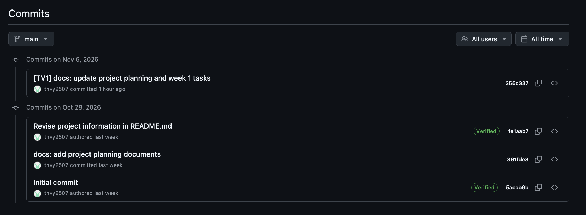
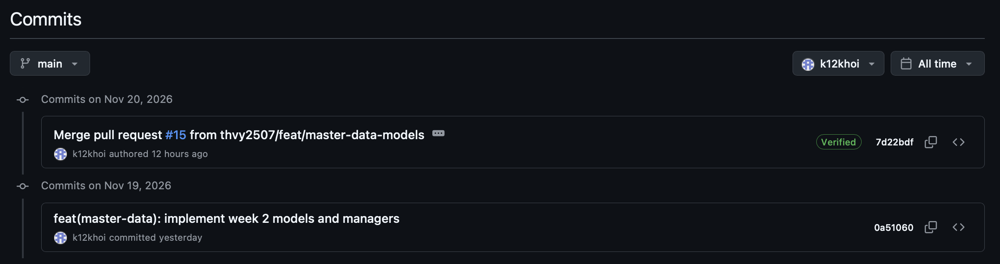
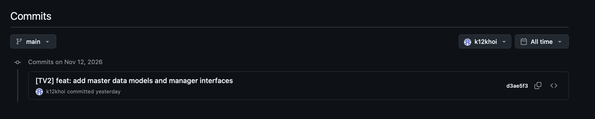
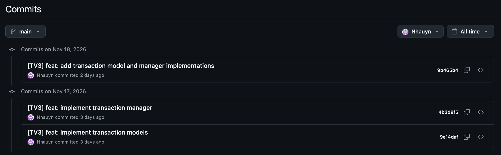
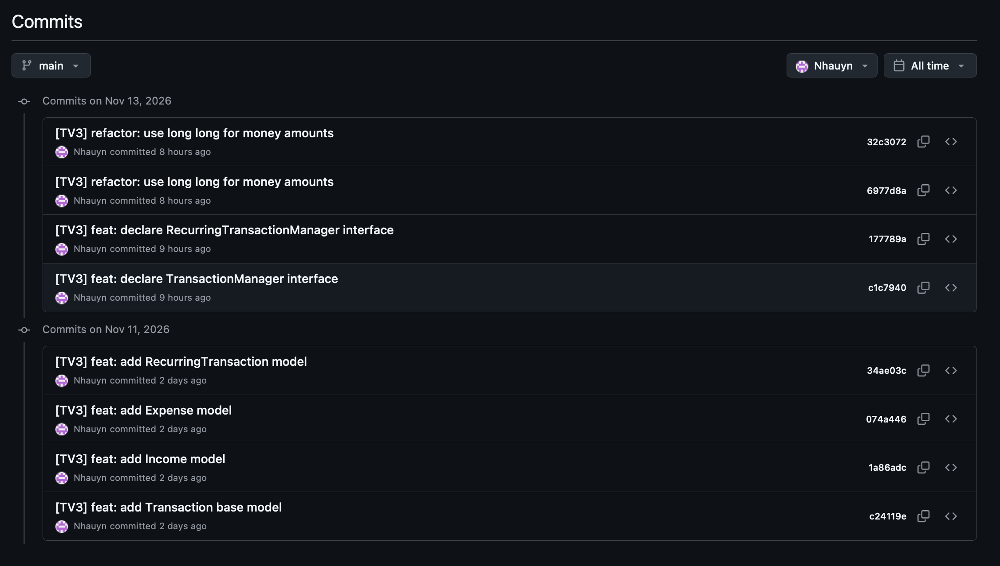
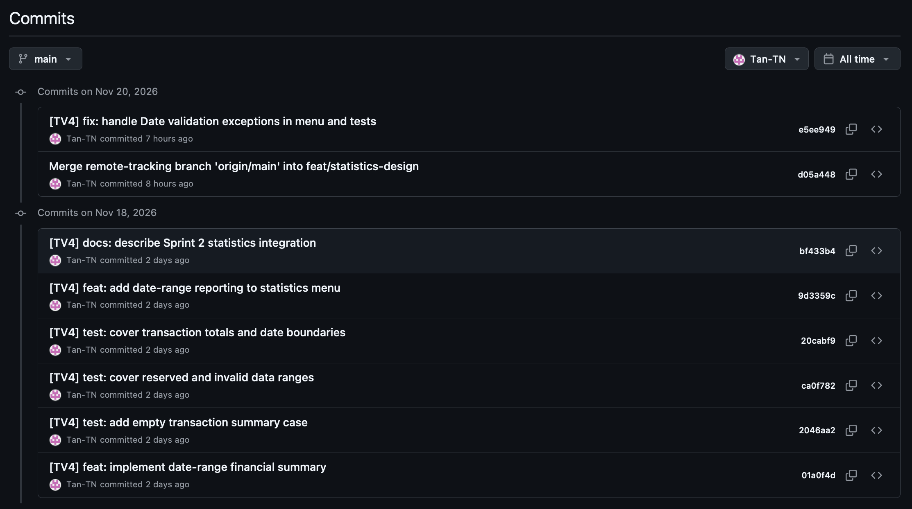
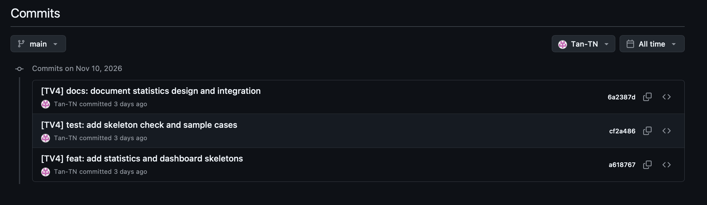

# Git Commit Log Total — Week 07

## 1. General Information

- **Group ID:** Group02
- **Project Name:** Personal Finance Manager
- **Course:** CS160-26A01
- **Reporting Period:** 28/10/2026 – 20/11/2026
- **GitHub Repository:** https://github.com/thvy2507/CS160-Group02-FinalProject
- **Branch:** `main`

This document records the **cumulative Git commit history** reachable from `main` from project initialization through **20 November 2026**, including commits originally developed on feature branches and subsequently merged.

**Counting Rules:** This log includes source code, tests, build configuration, project structure, coding conventions, and technical documentation directly related to implementation. Merge commits and documentation unrelated to development, such as weekly reports, are excluded. Each included commit is counted once.

**Commit Summary:** As of 20 November 2026, the filtered cumulative history contains 53 commits: 26 from previous weeks and 27 from Week 07. This log excludes the Week 07 report submission and subsequent documentation updates.

---

## 2. Team Member & GitHub Account Mapping

| Member | Student ID | Full Name          | GitHub Username |
| ------ | ---------- | ------------------ | --------------- |
| TV1    | 25125049   | Trần Hồng Vy       | `thvy2507`      |
| TV2    | 26125041   | Lê Thiện Khôi      | `k12khoi`       |
| TV3    | 26125089   | Dương Thị Nhã Uyên | `Nhauyn`        |
| TV4    | 26125070   | Trần Nhật Tân      | `Tan-TN`        |

---

## 3. Cumulative Git Commit Log

**25125049 - Trần Hồng Vy (TV1)**

> **GitHub Username:** `thvy2507`
> **Total Included Commits:** 30
> **Week 07 Included Commits:** 16

| Date       | Commit Hash                                                  | Commit Message                                               |
| ---------- | ------------------------------------------------------------ | ------------------------------------------------------------ |
| 28/10/2026 | [`361fde8`](https://github.com/thvy2507/CS160-Group02-FinalProject/commit/361fde8) | docs: add project planning documents                         |
| 06/11/2026 | [`355c337`](https://github.com/thvy2507/CS160-Group02-FinalProject/commit/355c337) | [TV1] docs: update project planning and week 1 tasks         |
| 07/11/2026 | [`adcdd29`](https://github.com/thvy2507/CS160-Group02-FinalProject/commit/adcdd29) | [TV1] build: initialize project structure                    |
| 07/11/2026 | [`2940d00`](https://github.com/thvy2507/CS160-Group02-FinalProject/commit/2940d00) | [TV1] build: set up CMake and CLI skeleton                   |
| 11/11/2026 | [`0dd49fa`](https://github.com/thvy2507/CS160-Group02-FinalProject/commit/0dd49fa) | [TV1] feat: implement DynamicArray core                      |
| 11/11/2026 | [`8ea082c`](https://github.com/thvy2507/CS160-Group02-FinalProject/commit/8ea082c) | [TV1] feat: extend DynamicArray operations                   |
| 11/11/2026 | [`d06f4f9`](https://github.com/thvy2507/CS160-Group02-FinalProject/commit/d06f4f9) | [TV1] test: add DynamicArray tests                           |
| 12/11/2026 | [`d91da5d`](https://github.com/thvy2507/CS160-Group02-FinalProject/commit/d91da5d) | [TV1] feat: implement Date utilities                         |
| 12/11/2026 | [`25cef6b`](https://github.com/thvy2507/CS160-Group02-FinalProject/commit/25cef6b) | [TV1] test: add Date validation and comparison tests         |
| 13/11/2026 | [`ae4934e`](https://github.com/thvy2507/CS160-Group02-FinalProject/commit/ae4934e) | [TV1] refactor: standardize master data interfaces           |
| 13/11/2026 | [`cef8b13`](https://github.com/thvy2507/CS160-Group02-FinalProject/commit/cef8b13) | [TV1] fix: align master data naming and comments             |
| 13/11/2026 | [`277ed28`](https://github.com/thvy2507/CS160-Group02-FinalProject/commit/277ed28) | [TV1] refactor: standardize transaction interfaces           |
| 13/11/2026 | [`e6fc147`](https://github.com/thvy2507/CS160-Group02-FinalProject/commit/e6fc147) | [TV1] refactor: align statistics with shared interfaces      |
| 13/11/2026 | [`8ed5371`](https://github.com/thvy2507/CS160-Group02-FinalProject/commit/8ed5371) | [TV1] build: integrate statistics and dashboard modules      |
| 17/11/2026 | [`959b6f6`](https://github.com/thvy2507/CS160-Group02-FinalProject/commit/959b6f6) | [TV1] docs: add sprint 2 implementation plan                 |
| 19/11/2026 | [`03e033b`](https://github.com/thvy2507/CS160-Group02-FinalProject/commit/03e033b) | [TV1] feat: implement input validation helpers               |
| 19/11/2026 | [`ba318bd`](https://github.com/thvy2507/CS160-Group02-FinalProject/commit/ba318bd) | [TV1] feat: implement CLI menu navigation                    |
| 20/11/2026 | [`cfd993c`](https://github.com/thvy2507/CS160-Group02-FinalProject/commit/cfd993c) | [TV1] fix: restore DynamicArray and align master data API    |
| 20/11/2026 | [`ade3aae`](https://github.com/thvy2507/CS160-Group02-FinalProject/commit/ade3aae) | [TV1] style: standardize master data coding conventions      |
| 20/11/2026 | [`51c6cb7`](https://github.com/thvy2507/CS160-Group02-FinalProject/commit/51c6cb7) | [TV1] test: verify transaction operations and wallet balance updates |
| 20/11/2026 | [`561bc22`](https://github.com/thvy2507/CS160-Group02-FinalProject/commit/561bc22) | [TV1] style: standardize transaction coding conventions      |
| 20/11/2026 | [`1aaa20f`](https://github.com/thvy2507/CS160-Group02-FinalProject/commit/1aaa20f) | [TV1] refactor: standardize statistics conventions and date input |
| 20/11/2026 | [`ddb2d30`](https://github.com/thvy2507/CS160-Group02-FinalProject/commit/ddb2d30) | [TV1] build: integrate master data and transaction modules   |
| 20/11/2026 | [`bec2f41`](https://github.com/thvy2507/CS160-Group02-FinalProject/commit/bec2f41) | [TV1] docs: update statistics integration and verification status |
| 20/11/2026 | [`e734d24`](https://github.com/thvy2507/CS160-Group02-FinalProject/commit/e734d24) | [TV1] feat: integrate master data operations                 |
| 20/11/2026 | [`baec448`](https://github.com/thvy2507/CS160-Group02-FinalProject/commit/baec448) | [TV1] feat: integrate income and expense operations          |
| 20/11/2026 | [`3874710`](https://github.com/thvy2507/CS160-Group02-FinalProject/commit/3874710) | [TV1] feat: integrate date-range statistics                  |
| 20/11/2026 | [`ff4a777`](https://github.com/thvy2507/CS160-Group02-FinalProject/commit/ff4a777) | [TV1] test: add CLI integration tests                        |
| 20/11/2026 | [`478f437`](https://github.com/thvy2507/CS160-Group02-FinalProject/commit/478f437) | [TV1] fix: prevent wallet balance overflow                   |
| 20/11/2026 | [`5efc884`](https://github.com/thvy2507/CS160-Group02-FinalProject/commit/5efc884) | [TV1] style: standardize core coding conventions             |

**Evidence:** .png)

.png)

.png)

.png)

**Commit Details:**

- **Commit 1 — [`361fde8`](https://github.com/thvy2507/CS160-Group02-FinalProject/commit/361fde8)** (28/10/2026)
  - **Message:** `docs: add project planning documents`
  - **Files:** `.gitignore`, `CODING_RULES.md`, `FILE_STRUCTURE.md`, `README.md`, `ROLES.md`, `WEEKLY_PLAN.md`
  - **Description:** Established the project's architecture, coding conventions, file structure, team responsibilities, and development plan.

- **Commit 2 — [`355c337`](https://github.com/thvy2507/CS160-Group02-FinalProject/commit/355c337)** (06/11/2026)
  - **Message:** `[TV1] docs: update project planning and week 1 tasks`
  - **Files:** `CODING_RULES.md`, `WEEKLY_PLAN.md`, `docs/plans/plan_for_week_1.md`
  - **Description:** Updated coding rules, the development schedule, and the initial implementation tasks.

- **Commit 3 — [`adcdd29`](https://github.com/thvy2507/CS160-Group02-FinalProject/commit/adcdd29)** (07/11/2026)
  - **Message:** `[TV1] build: initialize project structure`
  - **Files / Scope:** Initial `data/`, `include/`, `src/`, and `tests/` directories.
  - **Description:** Initialized the project directory structure for the Core, Models, Managers, Statistics, and UI modules.

- **Commit 4 — [`2940d00`](https://github.com/thvy2507/CS160-Group02-FinalProject/commit/2940d00)** (07/11/2026)
  - **Message:** `[TV1] build: set up CMake and CLI skeleton`
  - **Files:** `CMakeLists.txt`, `include/core/FinanceManager.h`, `src/core/FinanceManager.cpp`, `src/main.cpp`
  - **Description:** Added the C++17 CMake configuration and the main console menu skeleton.
- **Commit 5 — [`0dd49fa`](https://github.com/thvy2507/CS160-Group02-FinalProject/commit/0dd49fa)** (11/11/2026)
  - **Message:** `[TV1] feat: implement DynamicArray core`
  - **Files:** `include/core/DynamicArray.h`
  - **Description:** Introduced manual dynamic array allocation, object lifetime, deep copying and basic operations.
- **Commit 6 — [`8ea082c`](https://github.com/thvy2507/CS160-Group02-FinalProject/commit/8ea082c)** (11/11/2026)
  - **Message:** `[TV1] feat: extend DynamicArray operations`
  - **Files:** `include/core/DynamicArray.h`
  - **Description:** Extended the DynamicArray API with additional access and modification operations.
- **Commit 7 — [`d06f4f9`](https://github.com/thvy2507/CS160-Group02-FinalProject/commit/d06f4f9)** (11/11/2026)
  - **Message:** `[TV1] test: add DynamicArray tests`
  - **Files:** `tests/test_core.cpp`
  - **Description:** Added tests for array insertion, access, copying, removal and invalid indices.
- **Commit 8 — [`d91da5d`](https://github.com/thvy2507/CS160-Group02-FinalProject/commit/d91da5d)** (12/11/2026)
  - **Message:** `[TV1] feat: implement Date utilities`
  - **Files:** `CMakeLists.txt`, `include/core/Date.h`, `src/core/Date.cpp`
  - **Description:** Added Date validation, current-date initialization, leap-year rules and comparisons.
- **Commit 9 — [`25cef6b`](https://github.com/thvy2507/CS160-Group02-FinalProject/commit/25cef6b)** (12/11/2026)
  - **Message:** `[TV1] test: add Date validation and comparison tests`
  - **Files:** `tests/test_core.cpp`
  - **Description:** Added Date test cases for invalid dates, leap years and comparison operators.
- **Commit 10 — [`ae4934e`](https://github.com/thvy2507/CS160-Group02-FinalProject/commit/ae4934e)** (13/11/2026)
  - **Message:** `[TV1] refactor: standardize master data interfaces`
  - **Files:** `include/models/{Wallet,IncomeSource,ExpenseCategory}.h`, `include/managers/{Wallet,IncomeSource,ExpenseCategory}Manager.h`
  - **Description:** Aligned Master Data naming, money type, section comments and interface conventions.
- **Commit 11 — [`cef8b13`](https://github.com/thvy2507/CS160-Group02-FinalProject/commit/cef8b13)** (13/11/2026)
  - **Message:** `[TV1] fix: align master data naming and comments`
  - **Files:** `include/models/ExpenseCategory.h`, `include/models/IncomeSource.h`
  - **Description:** Corrected model member naming and comments.
- **Commit 12 — [`277ed28`](https://github.com/thvy2507/CS160-Group02-FinalProject/commit/277ed28)** (13/11/2026)
  - **Message:** `[TV1] refactor: standardize transaction interfaces`
  - **Files:** `include/models/{Transaction,Income,Expense,RecurringTransaction}.h`, `include/managers/{Transaction,RecurringTransaction}Manager.h`
  - **Description:** Standardized interface sections, invalid IDs and memory-ownership documentation.
- **Commit 13 — [`e6fc147`](https://github.com/thvy2507/CS160-Group02-FinalProject/commit/e6fc147)** (13/11/2026)
  - **Message:** `[TV1] refactor: align statistics with shared interfaces`
  - **Files:** `include/statistics/NumberFormatter.h`, `include/statistics/StatisticsManager.h`, `src/statistics/NumberFormatter.cpp`, `src/statistics/StatisticsManager.cpp`, `docs/integration.md`, `docs/statistics-design.md`, `tests/statistics-test-cases.md`, `tests/test_statistics.cpp`
  - **Description:** Changed statistics amounts to long long and replaced the abstract Transaction collection parameter with const TransactionManager&, updating documentation and tests.
- **Commit 14 — [`8ed5371`](https://github.com/thvy2507/CS160-Group02-FinalProject/commit/8ed5371)** (13/11/2026)
  - **Message:** `[TV1] build: integrate statistics and dashboard modules`
  - **Files:** `CMakeLists.txt`
  - **Description:** Added four Statistics and UI .cpp files to the main CMake executable.

- **Commit 15 — [`959b6f6`](https://github.com/thvy2507/CS160-Group02-FinalProject/commit/959b6f6)** (17/11/2026)
  - **Message:** `[TV1] docs: add sprint 2 implementation plan`
  - **Files:** `docs/plans/plan_for_sprint_2.md`
  - **Description:** Defined Sprint 2 implementation tasks, module dependencies, integration order, and testing requirements for all four members.

- **Commit 16 — [`03e033b`](https://github.com/thvy2507/CS160-Group02-FinalProject/commit/03e033b)** (19/11/2026)
  - **Message:** `[TV1] feat: implement input validation helpers`
  - **Files / Scope:** `include/core/FinanceManager.h`, `src/core/FinanceManager.cpp`
  - **Description:** Added integer, money, text and date input validation helpers.
- **Commit 17 — [`ba318bd`](https://github.com/thvy2507/CS160-Group02-FinalProject/commit/ba318bd)** (19/11/2026)
  - **Message:** `[TV1] feat: implement CLI menu navigation`
  - **Files / Scope:** `include/core/FinanceManager.h`, `src/core/FinanceManager.cpp`
  - **Description:** Implemented navigation between main and module menus.
- **Commit 18 — [`cfd993c`](https://github.com/thvy2507/CS160-Group02-FinalProject/commit/cfd993c)** (20/11/2026)
  - **Message:** `[TV1] fix: restore DynamicArray and align master data API`
  - **Files / Scope:** `include/core/DynamicArray.h`, `src/managers/WalletManager.cpp`, `src/managers/IncomeSourceManager.cpp`, `src/managers/ExpenseCategoryManager.cpp`
  - **Description:** Restored the shared array and aligned managers with its API.
- **Commit 19 — [`ade3aae`](https://github.com/thvy2507/CS160-Group02-FinalProject/commit/ade3aae)** (20/11/2026)
  - **Message:** `[TV1] style: standardize master data coding conventions`
  - **Files / Scope:** Master Data model and manager headers and source files; `src/tests/test_master_data.cpp`
  - **Description:** Standardized Master Data naming, organization and comments.
- **Commit 20 — [`51c6cb7`](https://github.com/thvy2507/CS160-Group02-FinalProject/commit/51c6cb7)** (20/11/2026)
  - **Message:** `[TV1] test: verify transaction operations and wallet balance updates`
  - **Files / Scope:** `tests/test_transaction.cpp`
  - **Description:** Added transaction tests for valid operations, references, amounts, balances and ID continuity.
- **Commit 21 — [`561bc22`](https://github.com/thvy2507/CS160-Group02-FinalProject/commit/561bc22)** (20/11/2026)
  - **Message:** `[TV1] style: standardize transaction coding conventions`
  - **Files / Scope:** `include/managers/TransactionManager.h`, `include/models/Expense.h`, `include/models/Income.h`, `include/models/Transaction.h`, `src/managers/TransactionManager.cpp`, `src/models/Transaction.cpp`
  - **Description:** Aligned Transaction interfaces and implementations with coding conventions.
- **Commit 22 — [`1aaa20f`](https://github.com/thvy2507/CS160-Group02-FinalProject/commit/1aaa20f)** (20/11/2026)
  - **Message:** `[TV1] refactor: standardize statistics conventions and date input`
  - **Files / Scope:** `docs/integration.md`, Statistics manager/menu headers and source files, `tests/test_statistics.cpp`
  - **Description:** Aligned Statistics naming, method organization and DD/MM/YYYY input.
- **Commit 23 — [`ddb2d30`](https://github.com/thvy2507/CS160-Group02-FinalProject/commit/ddb2d30)** (20/11/2026)
  - **Message:** `[TV1] build: integrate master data and transaction modules`
  - **Files / Scope:** `CMakeLists.txt`
  - **Description:** Added the required Master Data and Transaction implementation files to the application build.

- **Commit 24 — [`bec2f41`](https://github.com/thvy2507/CS160-Group02-FinalProject/commit/bec2f41)** (20/11/2026)
  - **Message:** `[TV1] docs: update statistics integration and verification status`
  - **Files:** `docs/integration.md`
  - **Description:** Updated Statistics integration documentation with implementation progress, build verification, and test results.

- **Commit 25 — [`e734d24`](https://github.com/thvy2507/CS160-Group02-FinalProject/commit/e734d24)** (20/11/2026)
  - **Message:** `[TV1] feat: integrate master data operations`
  - **Files / Scope:** `include/core/FinanceManager.h`, `src/core/FinanceManager.cpp`
  - **Description:** Connected Wallet, Income Source and Expense Category CRUD to the CLI.
- **Commit 26 — [`baec448`](https://github.com/thvy2507/CS160-Group02-FinalProject/commit/baec448)** (20/11/2026)
  - **Message:** `[TV1] feat: integrate income and expense operations`
  - **Files / Scope:** `include/core/FinanceManager.h`, `src/core/FinanceManager.cpp`
  - **Description:** Connected transaction creation and viewing to the CLI and existing balance operations.
- **Commit 27 — [`3874710`](https://github.com/thvy2507/CS160-Group02-FinalProject/commit/3874710)** (20/11/2026)
  - **Message:** `[TV1] feat: integrate date-range statistics`
  - **Files / Scope:** `src/core/FinanceManager.cpp`
  - **Description:** Connected the Statistics menu to the shared TransactionManager.
- **Commit 28 — [`ff4a777`](https://github.com/thvy2507/CS160-Group02-FinalProject/commit/ff4a777)** (20/11/2026)
  - **Message:** `[TV1] test: add CLI integration tests`
  - **Files / Scope:** `tests/test_cli.cpp`
  - **Description:** Added 33 automated checks for financial workflows, invalid input and EOF handling.
- **Commit 29 — [`478f437`](https://github.com/thvy2507/CS160-Group02-FinalProject/commit/478f437)** (20/11/2026)
  - **Message:** `[TV1] fix: prevent wallet balance overflow`
  - **Files / Scope:** `src/managers/WalletManager.cpp`, `src/models/Wallet.cpp`, `tests/test_transaction.cpp`
  - **Description:** Added overflow guards for active wallet totals and deposits and a regression test.
- **Commit 30 — [`5efc884`](https://github.com/thvy2507/CS160-Group02-FinalProject/commit/5efc884)** (20/11/2026)
  - **Message:** `[TV1] style: standardize core coding conventions`
  - **Files / Scope:** `include/core/FinanceManager.h`, `src/core/FinanceManager.cpp`
  - **Description:** Updated documentation, section comments and implementation order without changing business logic.

---

**26125041 - Lê Thiện Khôi (TV2)**

> **GitHub Username:** `k12khoi`
> **Total Included Commits:** 2
> **Week 07 Included Commits:** 1

| Date       | Commit Hash                                                  | Commit Message                                            |
| ---------- | ------------------------------------------------------------ | --------------------------------------------------------- |
| 12/11/2026 | [`d3ae5f3`](https://github.com/thvy2507/CS160-Group02-FinalProject/commit/d3ae5f3) | [TV2] feat: add master data models and manager interfaces |
| 19/11/2026 | [`0a51060`](https://github.com/thvy2507/CS160-Group02-FinalProject/commit/0a51060) | feat(master-data): implement week 2 models and managers   |

**Evidence:**

**Commit Details:**

- **Commit 1 — [`d3ae5f3`](https://github.com/thvy2507/CS160-Group02-FinalProject/commit/d3ae5f3)** (12/11/2026)
  - **Message:** `[TV2] feat: add master data models and manager interfaces`
  - **Files:** `include/models/Wallet.h`, `include/models/IncomeSource.h`, `include/models/ExpenseCategory.h`, `include/managers/WalletManager.h`, `include/managers/IncomeSourceManager.h`, `include/managers/ExpenseCategoryManager.h`
  - **Description:** Added Master Data model and manager declarations, wallet balance contracts, binary record structures and persistence hooks.

- **Commit 2 — [`0a51060`](https://github.com/thvy2507/CS160-Group02-FinalProject/commit/0a51060)** (19/11/2026)
  - **Message:** `feat(master-data): implement week 2 models and managers`
  - **Files / Scope:** Master Data model and manager headers and source files; `src/tests/test_master_data.cpp`, `include/core/DynamicArray.h`
  - **Description:** Implemented in-memory Master Data CRUD, ID management, wallet balance methods and standalone tests; included a temporary DynamicArray implementation later replaced during integration.

---

**26125089 - Dương Thị Nhã Uyên (TV3)**

> **GitHub Username:** `Nhauyn`
> **Total Included Commits:** 11
> **Week 07 Included Commits:** 3

| Date       | Commit Hash                                                  | Commit Message                                               |
| ---------- | ------------------------------------------------------------ | ------------------------------------------------------------ |
| 11/11/2026 | [`c24119e`](https://github.com/thvy2507/CS160-Group02-FinalProject/commit/c24119e) | [TV3] feat: add Transaction base model                       |
| 11/11/2026 | [`1a86adc`](https://github.com/thvy2507/CS160-Group02-FinalProject/commit/1a86adc) | [TV3] feat: add Income model                                 |
| 11/11/2026 | [`074a446`](https://github.com/thvy2507/CS160-Group02-FinalProject/commit/074a446) | [TV3] feat: add Expense model                                |
| 11/11/2026 | [`34ae03c`](https://github.com/thvy2507/CS160-Group02-FinalProject/commit/34ae03c) | [TV3] feat: add RecurringTransaction model                   |
| 13/11/2026 | [`c1c7940`](https://github.com/thvy2507/CS160-Group02-FinalProject/commit/c1c7940) | [TV3] feat: declare TransactionManager interface             |
| 13/11/2026 | [`177789a`](https://github.com/thvy2507/CS160-Group02-FinalProject/commit/177789a) | [TV3] feat: declare RecurringTransactionManager interface    |
| 13/11/2026 | [`6977d8a`](https://github.com/thvy2507/CS160-Group02-FinalProject/commit/6977d8a) | [TV3] refactor: use long long for money amounts              |
| 13/11/2026 | [`32c3072`](https://github.com/thvy2507/CS160-Group02-FinalProject/commit/32c3072) | [TV3] refactor: use long long for money amounts              |
| 17/11/2026 | [`9e14daf`](https://github.com/thvy2507/CS160-Group02-FinalProject/commit/9e14daf) | [TV3] feat: implement transaction models                     |
| 17/11/2026 | [`4b3d8f5`](https://github.com/thvy2507/CS160-Group02-FinalProject/commit/4b3d8f5) | [TV3] feat: implement transaction manager                    |
| 18/11/2026 | [`9b465b4`](https://github.com/thvy2507/CS160-Group02-FinalProject/commit/9b465b4) | [TV3] feat: add transaction model and manager implementations |

**Evidence:**

**Commit Details:**

- **Commit 1 — [`c24119e`](https://github.com/thvy2507/CS160-Group02-FinalProject/commit/c24119e)** (11/11/2026)
  - **Message:** `[TV3] feat: add Transaction base model`
  - **Files:** `include/models/Transaction.h`
  - **Description:** Declared the abstract Transaction model, shared properties and virtual transaction type.

- **Commit 2 — [`1a86adc`](https://github.com/thvy2507/CS160-Group02-FinalProject/commit/1a86adc)** (11/11/2026)
  - **Message:** `[TV3] feat: add Income model`
  - **Files:** `include/models/Income.h`
  - **Description:** Declared Income as a Transaction subtype linked to an income source ID.

- **Commit 3 — [`074a446`](https://github.com/thvy2507/CS160-Group02-FinalProject/commit/074a446)** (11/11/2026)
  - **Message:** `[TV3] feat: add Expense model`
  - **Files:** `include/models/Expense.h`
  - **Description:** Declared Expense as a Transaction subtype linked to an expense category ID.

- **Commit 4 — [`34ae03c`](https://github.com/thvy2507/CS160-Group02-FinalProject/commit/34ae03c)** (11/11/2026)
  - **Message:** `[TV3] feat: add RecurringTransaction model`
  - **Files:** `include/models/RecurringTransaction.h`
  - **Description:** Declared monthly recurrence fields, optional dates and duplicate-generation guards.

- **Commit 5 — [`c1c7940`](https://github.com/thvy2507/CS160-Group02-FinalProject/commit/c1c7940)** (13/11/2026)
  - **Message:** `[TV3] feat: declare TransactionManager interface`
  - **Files:** `include/managers/TransactionManager.h`
  - **Description:** Declared transaction CRUD, access methods and dependencies on Master Data managers.

- **Commit 6 — [`177789a`](https://github.com/thvy2507/CS160-Group02-FinalProject/commit/177789a)** (13/11/2026)
  - **Message:** `[TV3] feat: declare RecurringTransactionManager interface`
  - **Files:** `include/managers/RecurringTransactionManager.h`
  - **Description:** Declared recurring transaction CRUD and query interfaces.

- **Commit 7 — [`6977d8a`](https://github.com/thvy2507/CS160-Group02-FinalProject/commit/6977d8a)** (13/11/2026)
  - **Message:** `[TV3] refactor: use long long for money amounts`
  - **Files:** `include/models/RecurringTransaction.h`
  - **Description:** Made an incremental change to recurring transaction money declarations.

- **Commit 8 — [`32c3072`](https://github.com/thvy2507/CS160-Group02-FinalProject/commit/32c3072)** (13/11/2026)
  - **Message:** `[TV3] refactor: use long long for money amounts`
  - **Files:** `include/models/Transaction.h`, `include/models/Income.h`, `include/models/Expense.h`, `include/models/RecurringTransaction.h`
  - **Description:** Aligned transaction amounts with the team’s long long VND convention.

- **Commit 9 — [`9e14daf`](https://github.com/thvy2507/CS160-Group02-FinalProject/commit/9e14daf)** (17/11/2026)
  - **Message:** `[TV3] feat: implement transaction models`
  - **Files / Scope:** `src/models/Expense.cpp`, `src/models/Income.cpp`, `src/models/Transaction.cpp`
  - **Description:** Added Transaction, Income and Expense implementation files.
- **Commit 10 — [`4b3d8f5`](https://github.com/thvy2507/CS160-Group02-FinalProject/commit/4b3d8f5)** (17/11/2026)
  - **Message:** `[TV3] feat: implement transaction manager`
  - **Files / Scope:** `src/managers/TransactionManager.cpp`
  - **Description:** Added the TransactionManager implementation file.
- **Commit 11 — [`9b465b4`](https://github.com/thvy2507/CS160-Group02-FinalProject/commit/9b465b4)** (18/11/2026)
  - **Message:** `[TV3] feat: add transaction model and manager implementations`
  - **Files / Scope:** `src/managers/TransactionManager.cpp`, `src/models/Expense.cpp`, `src/models/Income.cpp`
  - **Description:** Completed the model and manager implementation changes for transaction creation and viewing.

---

**26125070 - Trần Nhật Tân (TV4)**

> **GitHub Username:** `Tan-TN`
> **Total Included Commits:** 10
> **Week 07 Included Commits:** 7

| Date       | Commit Hash                                                  | Commit Message                                               |
| ---------- | ------------------------------------------------------------ | ------------------------------------------------------------ |
| 10/11/2026 | [`a618767`](https://github.com/thvy2507/CS160-Group02-FinalProject/commit/a618767) | [TV4] feat: add statistics and dashboard skeletons           |
| 10/11/2026 | [`cf2a486`](https://github.com/thvy2507/CS160-Group02-FinalProject/commit/cf2a486) | [TV4] test: add skeleton check and sample cases              |
| 10/11/2026 | [`6a2387d`](https://github.com/thvy2507/CS160-Group02-FinalProject/commit/6a2387d) | [TV4] docs: document statistics design and integration       |
| 18/11/2026 | [`01a0f4d`](https://github.com/thvy2507/CS160-Group02-FinalProject/commit/01a0f4d) | [TV4] feat: implement date-range financial summary           |
| 18/11/2026 | [`2046aa2`](https://github.com/thvy2507/CS160-Group02-FinalProject/commit/2046aa2) | [TV4] test: add empty transaction summary case               |
| 18/11/2026 | [`ca0f782`](https://github.com/thvy2507/CS160-Group02-FinalProject/commit/ca0f782) | [TV4] test: cover reserved and invalid data ranges           |
| 18/11/2026 | [`20cabf9`](https://github.com/thvy2507/CS160-Group02-FinalProject/commit/20cabf9) | [TV4] test: cover transaction totals and date boundaries     |
| 18/11/2026 | [`9d3359c`](https://github.com/thvy2507/CS160-Group02-FinalProject/commit/9d3359c) | [TV4] feat: add date-range reporting to statistics menu      |
| 18/11/2026 | [`bf433b4`](https://github.com/thvy2507/CS160-Group02-FinalProject/commit/bf433b4) | [TV4] docs: describe Sprint 2 statistics integration         |
| 20/11/2026 | [`e5ee949`](https://github.com/thvy2507/CS160-Group02-FinalProject/commit/e5ee949) | [TV4] fix: handle Date validation exceptions in menu and tests |

**Evidence:**

**Commit Details:**

- **Commit 1 — [`a618767`](https://github.com/thvy2507/CS160-Group02-FinalProject/commit/a618767)** (10/11/2026)
  - **Message:** `[TV4] feat: add statistics and dashboard skeletons`
  - **Files:** `include/statistics/NumberFormatter.h`, `include/statistics/StatisticsManager.h`, `include/ui/Dashboard.h`, `include/ui/StatisticsMenu.h`, `src/statistics/NumberFormatter.cpp`, `src/statistics/StatisticsManager.cpp`, `src/ui/Dashboard.cpp`, `src/ui/StatisticsMenu.cpp`
  - **Description:** Added Statistics and Dashboard class interfaces and initial source skeletons.

- **Commit 2 — [`cf2a486`](https://github.com/thvy2507/CS160-Group02-FinalProject/commit/cf2a486)** (10/11/2026)
  - **Message:** `[TV4] test: add skeleton check and sample cases`
  - **Files:** `tests/test_statistics.cpp`, `tests/statistics-test-cases.md`
  - **Description:** Added a smoke-test entry point and expected financial report results for future implementation.

- **Commit 3 — [`6a2387d`](https://github.com/thvy2507/CS160-Group02-FinalProject/commit/6a2387d)** (10/11/2026)
  - **Message:** `[TV4] docs: document statistics design and integration`
  - **Files:** `docs/statistics-design.md`, `docs/integration.md`
  - **Description:** Documented report contracts, dashboard behavior and integration instructions.

- **Commit 4 — [`01a0f4d`](https://github.com/thvy2507/CS160-Group02-FinalProject/commit/01a0f4d)** (18/11/2026)
  - **Message:** `[TV4] feat: implement date-range financial summary`
  - **Files / Scope:** `src/statistics/StatisticsManager.cpp`
  - **Description:** Implemented income, expense and net balance totals over an inclusive date range.
- **Commit 5 — [`2046aa2`](https://github.com/thvy2507/CS160-Group02-FinalProject/commit/2046aa2)** (18/11/2026)
  - **Message:** `[TV4] test: add empty transaction summary case`
  - **Files / Scope:** `tests/test_statistics.cpp`
  - **Description:** Added a test for empty transaction data.
- **Commit 6 — [`ca0f782`](https://github.com/thvy2507/CS160-Group02-FinalProject/commit/ca0f782)** (18/11/2026)
  - **Message:** `[TV4] test: cover reserved and invalid data ranges`
  - **Files / Scope:** `tests/test_statistics.cpp`
  - **Description:** Added date-range validation test cases.
- **Commit 7 — [`20cabf9`](https://github.com/thvy2507/CS160-Group02-FinalProject/commit/20cabf9)** (18/11/2026)
  - **Message:** `[TV4] test: cover transaction totals and date boundaries`
  - **Files / Scope:** `tests/test_statistics.cpp`
  - **Description:** Added tests for totals and inclusive date boundaries.
- **Commit 8 — [`9d3359c`](https://github.com/thvy2507/CS160-Group02-FinalProject/commit/9d3359c)** (18/11/2026)
  - **Message:** `[TV4] feat: add date-range reporting to statistics menu`
  - **Files / Scope:** `include/ui/StatisticsMenu.h`, `src/ui/StatisticsMenu.cpp`
  - **Description:** Implemented interactive date-range reporting.
- **Commit 9 — [`bf433b4`](https://github.com/thvy2507/CS160-Group02-FinalProject/commit/bf433b4)** (18/11/2026)
  - **Message:** `[TV4] docs: describe Sprint 2 statistics integration`
  - **Files / Scope:** `docs/integration.md`
  - **Description:** Documented Statistics integration requirements.
- **Commit 10 — [`e5ee949`](https://github.com/thvy2507/CS160-Group02-FinalProject/commit/e5ee949)** (20/11/2026)
  - **Message:** `[TV4] fix: handle Date validation exceptions in menu and tests`
  - **Files / Scope:** `src/ui/StatisticsMenu.cpp`, `tests/test_statistics.cpp`
  - **Description:** Handled Date validation exceptions and corrected related tests.

---

## 4. Commit Summary

| Member                   | Previous Weeks | Week 07 | Total Commits |
| ------------------------ | -------------- | ------- | ------------- |
| TV1 - Trần Hồng Vy       | 14             | 16      | **30**        |
| TV2 - Lê Thiện Khôi      | 1              | 1       | **2**         |
| TV3 - Dương Thị Nhã Uyên | 8              | 3       | **11**        |
| TV4 - Trần Nhật Tân      | 3              | 7       | **10**        |
| **Total**                | **26**         | **27**  | **53**        |
